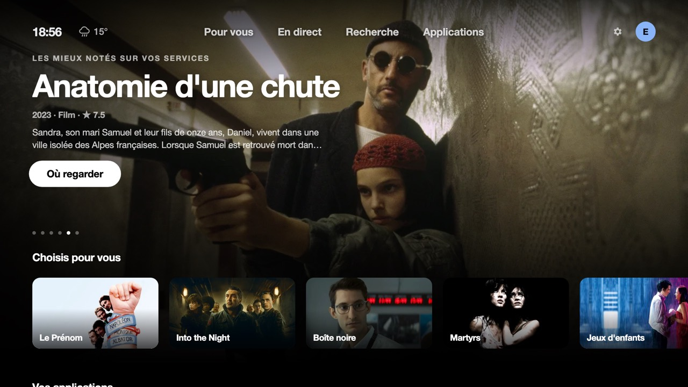
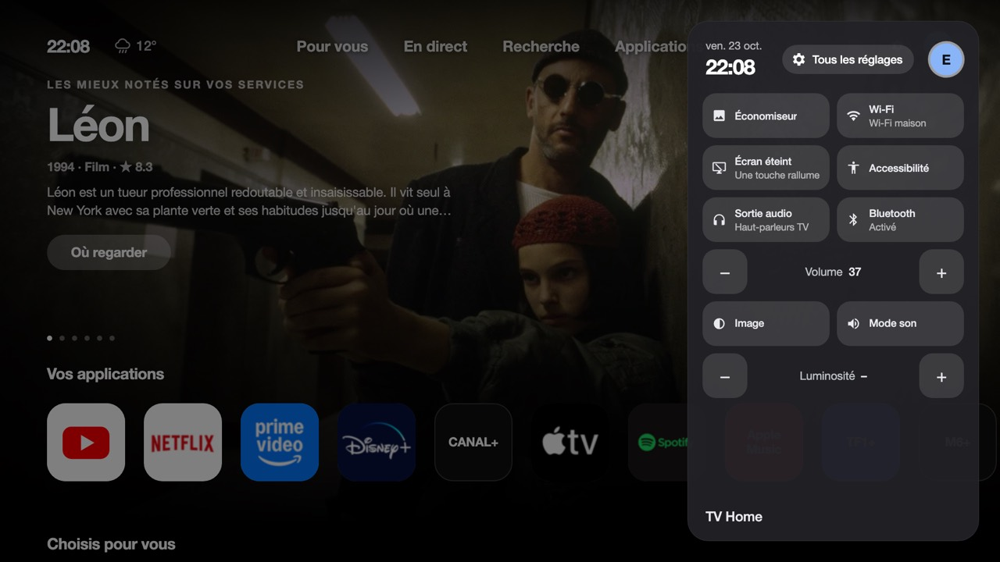
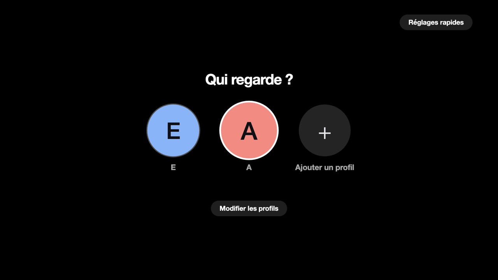

# TheBoringTV for LG webOS: French edition, Apple TV theme, a home replacement that keeps your soundbar

A Google TV-style (or Apple TV-style) home screen for LG webOS TVs. It's a plain HTML/CSS/JS web app with no build step.
This is a fork of [theboringhumane/theboringtv-lgwebos](https://github.com/theboringhumane/theboringtv-lgwebos), kept
close to upstream on purpose (English strings stay in the code, features live in separate files) so the two can follow
each other. **This README also describes how an LG C4 behaves when this app is its real home screen, and how the app deals with it.**
If you root your TV and want a custom home, read [Field notes](#field-notes-how-the-tv-behaves) first.

Built and tested on an **LG OLED65C44LA (C4, webOS 25, Chromium 120)** at 1920x1080 with an eARC soundbar (upstream was
tested on a 55UR8040). Works with the arrow keys, OK and Back, the Magic Remote pointer, and the scroll wheel.


| Rows with a blurred background | Details page with where to watch |
|:---:|:---:|
|  |  |
| **Search across services** | **Quick settings** |
|  |  |
| **Settings** | **Profiles** |
|  |  |
| **Ambient mode** | |
|  | |

**Apple TV theme** (Settings → Theme; the Google TV look stays the default):

| Home | Quick settings |
|:---:|:---:|
|  |  |
| **Details** | **Profiles** |
|  |  |

## Words used in this README
- **Rooted TV / Homebrew Channel:** a TV where you can log in as administrator over SSH. The [Homebrew Channel](https://github.com/webosbrew/webos-homebrew-channel) is the community app that gives that access and runs your scripts at boot. Only the "rooted" parts below need it; the app itself runs on any LG webOS TV in Developer Mode.
- **sam:** webOS's app manager (the system part that starts and stops apps). Restarting it is what breaks the soundbar link here.
- **eARC / ARC:** the HDMI connection that sends the TV's sound to a soundbar.
- **Quick Start+:** an LG setting that keeps the TV half-awake in standby so it wakes in a few seconds.
- **Helper service (`tools/tv-service`):** a small program that runs on the TV itself, outside the app, for things a web page is not allowed to do.
- **Luna / `luna-send`:** webOS's internal request system and its command-line tool.

## What this fork adds to upstream
- **A way to be the home screen that does not break eARC/ARC soundbars.** Upstream's recommended method restarts the TV's
  app manager at boot, which on our TV drops the soundbar until a full power cycle. We use the Home key's own setting
  (`setDefaultApp`) plus a small watcher instead. See [Make it the real home screen](#make-it-the-real-home-screen-rooted-tvs).
- **A helper service outside the app** (`tools/tv-service`, port 45621): installed apps and real icons, HDMI input names, picture/sound/
  brightness/volume, screen off, the TV's microphone, a Home-key watcher, a "back to TV Home" watcher, startup timings.
- **An Apple TV theme** (`features/tvos.css`, scoped to `body.theme-tvos`, only transform/opacity transitions so it stays cheap).
- **French edition** (`features/i18n.js`): the interface is translated as it appears, titles and descriptions from TMDB untouched.
  Settings → Interface language switches to English.
- **Fast start** (see [Performance](#performance-on-a-weak-tv-cpu)): the loading screen goes away ~0.4 to 0.7 s after the page opens, without waiting for the network.
- **More recommendations:** "Picked for you", "Top rated on your services", "New on your services", your apps right under the hero.
- **Apps:** hide / reorder / uninstall with a long OK, a list of hidden apps to bring back, a shortcut to LG's own home, HDMI inputs with the name of what is plugged in.
- **Search:** AZERTY / QWERTY / ABC keyboard, a clear button, and **voice dictation** with the TV's own microphone (see below).
- **A real "seen" list:** mark titles as seen or "not interested", get asked "Seen it?" after you come back from a streaming app, optional **Trakt** sync, and an import of the
  history you download from a streaming service. Seen titles are never suggested again (see [Watch history](#watch-history-seen-trakt-import)).
- **Sharp pictures, or none:** a picture that fills the screen must be at least 2560 px wide, otherwise the title only appears as a card (see [Pictures](#pictures-sharp-or-none)).
  The featured title goes straight to TMDB's full-size file, the details page fades from a blurred copy to the sharp picture, and it starts loading while you rest on a card.
- **A calmer first view:** the hero is the title, one line (year, type, rating), the synopsis and one button ("View details", which is what OK really does); no pagination dots, no "because you
  watched…" line (its space is kept); the focus starts on the first app, one press from the apps; the round profile button only appears when there are several profiles.
- **Home Assistant washing machine pill** next to the weather (optional).
- **Profiles:** free-text names with the on-screen keyboard, delete confirmation, "who is watching?" asked once per session.
- **Screen off** from the quick settings (the sound keeps playing), and a power-off that is instant (see the field notes).
- **Safer preview:** the dev server is bound to `127.0.0.1` (see Setup), `keys.js` stays git-ignored.

## Features
- **Hero and rows:** full-screen featured titles, "Picked for you", one "Popular on …" row per streaming service you chose in Settings
  (Netflix, Prime Video, Disney+, Apple TV+, Canal+ and Crunchyroll are known by default; add others in `config.js`) and
  "Trending on YouTube", using [TMDB](https://www.themoviedb.org/) and the YouTube Data API.
- **Where to watch:** pressing OK on a title opens a details page with "Watch on …" buttons for the services that
  stream it in your country, a trailer, cast and "More like this".
- **Watchlist ("À voir" in French), Continue watching:** both saved on the TV. Netflix and the other apps don't share their watch history, so without Trakt
  Continue watching lists the titles you opened from this home screen; with Trakt it follows Trakt's progress (see below). Hold OK on a card of Continue watching for its details page.
- **Search across services:** an on-screen keyboard; each result shows where it's streaming.
- **Your apps:** checks a list of known apps (webOS won't list installed apps to non-system apps) and opens them; on a rooted TV the helper service lists every installed app.
- **Settings:** country, recommendation languages (pick several), which services get rows, clock, theme, and more.
- **Quick settings panel:** Wi-Fi, audio output, Bluetooth, volume, screensaver, inputs, picture and sound mode, brightness, screen off.
- **Seen / not interested:** two more buttons on the details page; the "Recently finished" row; the suggestions learn from what you saw.
- **Profiles:** each has its own settings, watchlist and history, plus a kids profile (family-friendly titles, some apps hidden).
- **Apps tab:** hold OK on an app (or the pencil tile) for the edit mode: **Hide / show**, **Reorder** and, on a rooted TV, **Uninstall** (a second OK within 4 s confirms; only apps the TV itself says are removable, never LG's system apps, TV Home, its idle screen or the Homebrew Channel). A red **LG Home** tile opens LG's own home screen, which the helper otherwise sends straight back to TV Home (it lets it stay for 90 s).
  Pressing Home from an app brings you back to the card you were on. Editing the list only redraws the grid, not the home rows (they are built when you go back to the home screen).
- **Ambient mode:** a slideshow of artwork (only pictures sharp enough, full-size by default; Settings → Picture quality keeps the lighter ones) with the clock in bold, the date and the weather when the TV is idle.
  Any key leaves it; OK (or a pointer click, without moving the pointer) opens the details page of the title on screen. The "Screensaver" tile of the quick settings starts it.
  **Dimming:** a black veil over the whole idle screen (pictures and texts) that gets darker the longer it stays on, to lower the light of every lit pixel (what wears an OLED): from 30 % at the start to 45 % after a
  minute, 59 % after 5 and 72 % after 20 (Settings → Idle screen dimming: Light up to 45 %, Standard up to 72 %, Strong up to 85 %). LG's own screensaver lowers the panel's luminance through an undocumented call of the picture
  service (`pqcontroller/reduceLuminance`, whose parameters are not published); TV Home dims with the veil instead and never calls it.
  **Burn-in care:** the clock block (time, date, weather) and the title block shift a little so the strokes of the texts do not always light the same pixels: a small zone (at most 56 px across, 36 px up), ONE random
  offset for both blocks (the left one by (dx, dy), the right one by (-dx, dy)) so they keep the same line and the same margins, moves of 2.5 to 5 minutes (a few tenths of a pixel per second, not seen moving) each
  followed by a rest of 2 to 5 minutes, never a cycle: each point is drawn at random, at least 24 px from the previous one, and the last one is kept for the next time. **Instead of LG's screensaver** (rooted TV): see [LG's screensaver, replaced](#lgs-screensaver-replaced-rooted-tvs).

## Setup
1. Copy `keys.example.js` to `keys.js` and add a free TMDB API key and a YouTube Data API v3 key (the optional
   Home Assistant and speech-server entries are explained in that file). `keys.js` is gitignored.
2. Set your region, services and apps in `config.js`.
3. Preview it in a browser, **bound to your own machine**: `keys.js` sits in that folder, and a plain
   `python3 -m http.server` listens on every network interface, so anyone on your Wi-Fi could read your keys.
   ```bash
   python3 -m http.server 8765 --bind 127.0.0.1
   ```
   Then open http://127.0.0.1:8765/tools/preview/preview.html (the page scales to your window; the buttons switch theme; arrow keys, Enter and Esc act as the remote, Esc is Back),
   or http://127.0.0.1:8765 in a 1920x1080 window.
   `tools/preview/shot.html?keys=down,right*2,enter` and `probe.html` replay remote keys for screenshots and focus traces with headless Chrome
   (`--screenshot`, `--dump-dom`); `marks.html` prints the start-up timings.

## Install on the TV
Turn on LG's Developer Mode (or use a rooted TV), install the [webOS CLI](https://www.npmjs.com/package/@webos-tools/cli),
and add your TV with `ares-setup-device`. Then:
`-e` leaves a folder out of the package (dev tools, screenshots, upstream's optional `service/`, git data):
```bash
ares-package . -e tools -e docs -e service -e ambient -e .git -o /tmp --no-minify
```
```bash
ares-install --device tv /tmp/com.boring.tvhome_*.ipk
```
```bash
ares-launch --device tv com.boring.tvhome
```
`ambient/` is a second, tiny app (the light idle screen, see [LG's screensaver, replaced](#lgs-screensaver-replaced-rooted-tvs)): rooted TVs install it with `TV_HOST=root@<tv-ip> sh tools/tv-service/install-ambient.sh`.
Without it TV Home's own idle screen is used everywhere, which is fine except over a music app (see below).
Developer Mode installs expire after 50 hours unless you extend them in the Developer Mode app.
On a rooted TV, installing an update does **not** restart anything (and never run `systemctl restart sam`: see the field notes).

## Make it the real home screen (rooted TVs)
Root the TV with the [Homebrew Channel](https://github.com/webosbrew/webos-homebrew-channel) first (see
[e.nya.je/getroot](https://e.nya.je/getroot/); at your own risk: it may void your warranty, and a firmware update can remove root).
Nothing below modifies LG's system files; everything is a TV setting, a RAM-only mount, or a script kept in `/media/developer` that the Homebrew
Channel runs at boot, and each step has an undo.

### Option 1 (recommended, what we run): the Home key's own setting + a watcher
No restart of the app manager (`sam`), so an eARC/ARC soundbar is never disturbed.

1. TV Home's `appinfo.json` declares `"appCategory": ["home"]` (already the case here). Without it sam stores the next step and then
   fails every Home press with "no default app is set for the category".
2. Tell webOS 25 which app the Home key opens (sam keeps it in the `defaultApps` setting):
   ```bash
   scp tools/tv-boot-settings/default-home.sh root@<tv-ip>:/tmp/ && ssh root@<tv-ip> 'sh /tmp/default-home.sh on'   # 'off' puts LG's home back
   ```
   The setting survived a cold start (power unplugged) on our TV; some projects report it being lost on theirs, so check after your first cold boot.
3. Install the helper service. It opens TV Home whenever LG's home comes to the front (Back out of an app, wake from standby, the
   first seconds after boot), and opens TV Home from native apps like Netflix that swallow the Home key:
   ```bash
   TV_HOST=root@<tv-ip> tools/tv-service/install.sh
   ```
   It is linked into `/var/lib/webosbrew/init.d/20-launcher-service` (the `20-` matters: init.d scripts run in name order, and a slow
   script before it delays TV Home at boot). Remove the link and kill the process to undo.
4. Choose a boot profile (below).

What you get: the Home key and Back go to TV Home, with LG's home flashing for a moment on Back and on wake (about 0.3 to 3 s here).

### Boot profiles (two TV settings, measured on an LG C4)
| Profile | `lastInputApp` / `homeAutoLaunch` | Wake from standby (Quick Start+) | Cold start (power plugged back in) |
|---|---|---|---|
| **A** LG's defaults | `livetv` / `on` | LG home ~2 s, TV Home ~3 s later | LG home ~15 s, then TV Home |
| **B** (what we run) | TV Home / **off** | **TV Home in ~4 s** | **black screen ~27 s**, TV Home ~3 s after the Hue-sync notification |
| **C** | TV Home / **on** | LG home 2 s, TV Home at ~5 s | LG home at ~10 s, TV Home at ~24 s |

Run them on the TV, e.g. `ssh root@<tv-ip> 'sh -s' < tools/tv-boot-settings/boot-on.sh`.
`boot-on.sh` applies B (it saves your original values in `/var/lib/webosbrew/tvhome-settings.before`),
`boot-hybrid.sh` applies C, `boot-off.sh` goes back to A. Pick B if you wake the TV from standby all day and rarely lose power,
C if cold starts matter more. Home Auto Launch is what makes the TV open LG's home by itself after power returns; it also decides
whether the wake goes through LG's home. The black screen in B lasts until the Homebrew Channel runs its scripts (see the field notes).

### Option 2: replace LG's home with a RAM copy (upstream's method; breaks eARC on some TVs)
The packaging and install steps for Options 2 and 3 are upstream's (`ares-package . service …`, see its README); only the findings are repeated here.
`service/as-home.sh` (upstream) copies TV Home into RAM, gives the copy LG home's app id (`com.webos.app.home`), bind-mounts it over LG's
home and **restarts sam** so it picks the copy up. webOS then opens TV Home everywhere it would open LG's home, including Back and startup.
It worked, but restarting sam made the TV drop its eARC soundbar (details below). If you use it, `tools/tv-home-as-home/` has our
adapted copies (`boot-as-home.sh` skips the settings part, `refresh.sh` updates the RAM copy in place without restarting sam, `undo.sh`
removes the link and the mounts and restores the settings). Use one option, not both.

### Option 3: only watch the Home key
`service/service.js` (upstream) reads the remote without grabbing it and opens TV Home after each Home press, at startup and after standby;
LG's home still flashes and Back from apps still goes to LG's home. Our `tools/tv-service` does the same and more (it also follows the foreground app).
`HOME_CODE` is 773 on LG Magic Remotes; the key events are `struct input_event` records of 16 bytes on the TV's 32-bit input nodes.

## Field notes: how the TV behaves
All measured on one LG C4 (webOS 25) with a Sonos Beam on eARC, Homebrew Channel root. Your numbers will differ; the mechanisms probably won't.

**1. The soundbar disappeared after TV Home became the home app (eARC / ARC lost).**
- *Symptom:* sound output flipped to the TV speakers, then the volume keys showed a "forbidden" sign even after choosing the soundbar again.
  `getARCState` said `arcActivation: "None"` (healthy is `"eARC"`), and the CEC log (`/var/log/cecmessages`) filled with unanswered
  "Request ARC Initiation" messages and "ARC NOT INITATE -> SKIP SEND <System Audio Mode Request>".
- *Cause:* every `systemctl restart sam` (upstream's as-home does it at each boot, and a live install did it too) resets the TV's CEC/ARC
  state. At boot it is a race: if the script ran before the ARC negotiation (~20 s after power on) all was fine, if it ran during or after it, the soundbar was lost.
- *What does not recover it:* choosing the output again, toggling `eArcSupport` off/on (ARC initiates for a moment, then drops). Only a full power cycle (unplug 30 s) does.
- *How to avoid it:* never restart sam; use Option 1; update the app with a plain install (no restart) or refresh the RAM copy in place.
- *Check:* `luna-send -n 1 -f luna://com.webos.service.arccontroller/getARCState '{}' </dev/null | grep arcActivation` should say `eARC` after any change.

**2. Home from native apps (Netflix, YouTube) did nothing or showed the pointer.** Those apps handle the key themselves and never hand it to the system.
`tools/tv-service` reads `/dev/input/event*` (read only, polled every 50 ms) and opens TV Home after each Home press.
With Option 1 it also subscribes to `getForegroundAppInfo` and opens TV Home when `com.webos.app.home` (LG's home) comes to the front, with at most
3 launches in 30 s so a failing launch can never loop.

**3. Power off took ~5 s with no feedback; the screen stayed on and usable.** The remote's power key puts the power service (`tvpowerd`) in a
"Request Power Off Logo" phase: it waits for clients (`com.webos.surfacemanager`, `com.webos.service.audio`, `pqcontroller`) to show the LG logo and
answer, and goes to standby exactly 5.0 s later. With TV Home in front no logo was shown, so nothing happened for 5 s. The CEC "Standby" to the soundbar
left within a second, so it was not the soundbar. Fix: turn the logo off,
```bash
luna-send -n 1 -f luna://com.webos.settingsservice/setSystemSettings '{"category":"other","settings":{"lgLogoDisplay":"off"}}' </dev/null
```
Power off then reached standby in 0.4 s. Side effect: no LG logo at power off (we did not check power on). Put it back with `"on"`.
You can watch the phases yourself: `luna-send -i luna://com.webos.service.tvpower/power/getPowerState '{"subscribe":true}'`.

**4. Cold start: black screen, or LG's home first.** Scripts in `/var/lib/webosbrew/init.d/` are run by the Homebrew Channel's `startup.sh` once
it is triggered, which on our TV was 15 to 34 s after power on (about when the system finishes booting; it varied between boots). Nothing of ours can run
before that. With Home Auto Launch off the screen is black until then; with it on LG's home shows from ~10 s. webOS does mark TV Home as "in front" earlier
when it is the last input, but its window stays hidden until the app is launched again, so the service launches it twice at boot (about 12 s apart, only in
the first 4 minutes after power on, and only if nothing else is in front). Starting TV Home from an early script does not help either: a partially preloaded app does not run its scripts for ~54 s. See the boot profiles for the trade-off.

**5. `luna-send` over SSH prints nothing.** When its stdin is a pipe or heredoc it stays silent: use `</dev/null` (or `ssh -tt`). `-f` formats the reply.
On the TV's busybox, `ls --time-style` and `date -d` don't exist; `timeout` doesn't exist on macOS either.

**6. Two copies of TV Home do not share their settings.** With Option 2 the regular TV Home app and the copy that runs as `com.webos.app.home` have separate storage
(settings, history, watchlist). With Option 1 there is only one instance, so one set of settings.

**7. A debloat list can block LG's voice assistant.** If a debloat script's block list includes the voice and assistant apps, the microphone button of the remote does nothing: check the list before blaming the app. The TV's far-field microphone is a unix socket (16 kHz, 16 bit,
mono, raw); `tools/tv-service` streams it over `GET /mic`.

**8. Crunchyroll deep links:** the official app ignores every parameter format tried (13), so "Watch on Crunchyroll" simply opens the app.

**9. Two layers swapping a z-index cross any veil between them.** The blurred background behind the rows is two layers that fade into each other by swapping `z-index` 1 / 0. With a dark veil of a neutral level between the home screen and its rows, the layer in front sits above the veil and the one underneath below it:
every change dips to the shaded picture and back (measured by recording the screen: two identical grey pictures went from luminance 119 to 48 and back; the opacities were fine). The two layers therefore live in a stacking context of their own, together above the veil (the same arrangement keeps the details page's background layers under its text).

**10. The home screen is drawn from its cache first.** It is drawn before the features have registered their rows (watchlist, recently finished) and is not rebuilt when the fresh data equals the cache (nor refreshed at all from the network when the cache is under 30 minutes old); the Apps grid is built before the app list has loaded. So both are built again once what they were missing is known.

**11. The helper may not start after a cold boot (seen once).** Symptoms: the Apps page shows only the apps listed in `config.js` (the full list comes from the helper), the quick settings say the service is needed, the colour buttons and the power events
no longer reach Home Assistant, `ssh` is refused. Unplugging the TV for a few seconds brings everything back. The logs of that boot were gone (`/tmp` and `/var/log` are emptied at each boot), so the cause is not established (a Wi-Fi outage that night, a system
update that removed the elevation, or a start that failed are all possible). The helper writes `/media/developer/tv-service/service.log` on the flash (100 KB then `service.log.1`, no start-up timings): its first line, `start: helper v3, pid ..., the TV has been up N s`,
is written at every start, so after a boot where it is missing the helper never started, and one where it is present and followed by a `stop:` or `uncaught:` line says how it ended. The Homebrew Channel is in the fallback app list, so it stays reachable when the helper is down.

**12. LG's screensaver app cannot always be left with the remote.** Launched from TV Home (`com.webos.app.screensaver`), it did not hand the remote back reliably, so the quick-settings tile starts TV Home's own ambient mode instead.

**13. Launching a whole app over a music app suspends the music.** See [the light idle screen](#the-light-idle-screen-why-tv-home-itself-cannot-be-put-over-a-music-app): the window type does not matter, the weight of the app does.

**14. A hidden page does not run.** webOS freezes the timers of a web app that is not in front: anything the helper needs from the page (the idle screen's data, the setting) must be sent while the page is visible and kept by the helper.

**15. Uninstalling.** `appInstallService/remove` (store apps) and `appInstallService/dev/remove` (developer-mode apps, under `/media/developer`) take `{id}`, answer at once and go on in the background (states `app closing`, `removing`...): the helper waits until the app is gone from `getAppInfo`. The TV marks LG's own apps `removable: false`/`systemApp: true`; Netflix, YouTube, Apple Music... are `removable: true`.
The helper refuses TV Home, its idle screen and the Homebrew Channel even though the TV calls them removable.

## Voice dictation (optional)
The search keyboard has a microphone key. The page reads the TV's microphone from the helper service, cuts a sentence at the silence, and sends it to
a speech-to-text endpoint, then snaps the answer to the closest title it knows (a mis-heard title is corrected). Two backends, set in `keys.js` (see `keys.example.js`):
- **Your own server** (`STT_URL` + `STT_TOKEN`, preferred): `POST <STT_URL>/transcribe?lang=fr` with the raw 16 kHz 16-bit mono audio, a
  `Authorization: Bearer` header and an `X-Prompt` header carrying known titles (URL-encoded); it answers `{"text": "..."}`. We run a small Whisper
  server on a Mac (large-v3-turbo through MLX); anything that speaks this protocol works. Keep it on your home network with a token.
- **Home Assistant** (`HA_URL`, `HA_TOKEN`, `HA_STT_PIPELINE`): through an Assist pipeline that has a speech-to-text engine.

## Performance on a weak TV CPU
The TV's CPU is far slower than a laptop, so we measure on the TV: the app records start-up marks (`scripts`, `cache-parsed`, `rows-built`,
`cache-drawn`, `boot-hidden`, `first-bg`, `net-home-ready`, first paint) and, on a rooted TV, sends them to the helper's log (`grep perf /tmp/launcher-service.log`);
off the TV they are in `localStorage.perfMarks` and `tools/preview/marks.html` prints them.
How it is built for it (measured on the LG C4, relaunch with the cached home):
- The loading screen goes away as soon as the cached home is drawn (about 0.4 to 0.7 s after the page opens), not at `window.load`, which waits for the network images. The stylesheets are plain blocking links (loading them with the `media="print"` trick only adds re-layouts).
- The translator's `MutationObserver` would re-walk every new element after each build (~350 ms on the TV). Rows and the app grid are translated before they are
  attached (and marked so the observer skips them), the observer drops the records of its own writes, and translations are memoised.
- The first frame of a big page is slow to lay out: only the first 3 rows are built before the first paint, the others follow one per tick.
- If the fresh data equals the cached screen nothing is rebuilt (no lost focus, no image re-decoding). With no cache at all, the hero and the apps are drawn as soon as the first two answers arrive.
- GPU memory: only the row being moved gets `will-change: transform` (a long row is ~14000 px wide); the Apple theme creates its focus sheen and shadow only on the focused tile and uses
  almost opaque panels instead of `backdrop-filter`.
- Timers (clock, weather, washer) stop while the page is in the background; webOS keeps it alive after Home.
- **Memory first.** The TV has 2 GB, nearly all used. What fills the page is decoded pictures: the two background layers (63 MB if both keep a 4K picture), the idle screen's two slides (51 MB), 78 cards of 500 px (41 MB), out of ~193 MB for the page. So a layer or slide that is covered or hidden lets its picture go
  (`removeAttribute('src')`); the page then holds ~100 MB and the TV has ~270 MB free instead of ~105 MB.
- **Cold start.** The system closes TV Home in the background, so most opens are cold. The network refresh of the home is skipped when the cached home is less than 30 minutes old (about 30 requests fewer); the refresh's TMDB requests go through a queue of 4 that waits while another page is open, so a details page is not stuck behind them; the list of streaming providers is kept a week;
  apps load in parallel with the rows; the first weather call waits 2.5 s.
- **Details page:** two parallel calls, the first (overview, runtime, genres, where to watch, trailer) paints the page and the buttons, the second (cast, "More like this") fills in afterwards; every call has a time limit and a failure says so; answers are slimmed to what is displayed (40 titles in memory) and the first one is kept 6 hours in `localStorage`
  (`detailsA.v1`); the pictures list is the existing `refineBest` cache instead of the `images` payload. Trakt's start-up sync waits for the home screen and sends at most 3 TMDB calls at a time.
- **Apps tab, edit mode.** A press (enter, hide, move, uninstall, leave) redraws only the grid: the home (~210 cards, ~1500 elements) is not visible then, so its rows are built when the home screen comes back, and only if the list changed.
- **Helper service.** One reader of the remote's key events (50 ms polling), one parse of `events.json`, shared luna subscriptions, a 413 for a request body over 256 KB.
- Full-size pictures cost: a 3840x2160 backdrop is ~33 MB once decoded. They are fetched and decoded only for the picture that rests on screen (and the details page of the card that rests), never while a key is held,
  and the old layer stays under the new one until the fade is over (hiding it on a timer races the CSS fade on the slow CPU and shows a dark frame), then lets its picture go.

## Rooted extras: real apps, picture and sound, inputs, remote control
With the helper service running (rooted TV), the page gets what a normal app can't. The service runs as root and calls a fixed list of system methods,
which the page reaches over the TV's loopback (`127.0.0.1:45621`, host and origin checked):
- **Your apps** shows every installed app with its real icon, not the list in `config.js`; **HDMI inputs** carry the name of what is plugged in (from `eim/getAllInputStatus`).
- **Uninstall and LG Home** (Apps tab, see Features): `POST /uninstall {id}` and `POST /lghome`. The first only accepts apps the TV lists as removable and that are not in the helper's protected list (`KEEP_APPS`); the second launches LG's home and tells the foreground watcher to leave it alone for 90 s.
- **Quick settings** gets picture mode, sound mode, brightness, a row of inputs and **Screen off**, which keeps audio playing; any remote key turns the screen back on.
- Upstream's `service/service.js` (port 45620) is a second, separate helper. It does the deep-link id lookups (Prime Video, JioHotstar; without it those titles open the app's home)
  and `tools/tv` below talks to it for picture, sound and screen commands. Packaging and installing it is described in upstream's README.

`tools/tv` controls the TV from your computer over SSH:
```bash
export TV_IP=192.168.1.50 TV_MAC=aa:bb:cc:dd:ee:ff   # your TV; the MAC is only needed for "on"
tools/tv volume 20        # or up, down, mute, unmute
tools/tv input hdmi1
tools/tv launch netflix   # tools/tv apps lists ids
tools/tv picture cinema   # backlight 0-100, sound movie, screen-off, home, off, on, status
```
For Home Assistant, its built-in **LG webOS Smart TV** integration already controls power, volume, inputs and apps
over the TV's own network API, with no root needed. Use `tools/tv` (from a shell command) for the extras.
The optional washing machine pill reads three Home Assistant entities over its WebSocket (`HA_WASHER` in `keys.js`); the token never leaves `keys.js`.

## LG's screensaver, replaced (rooted TVs)
LG's screensaver (`com.webos.app.screensaver`, a Flutter app started by the power service after `screenSaverTimer` minutes without a key press; LG says it works except during full-screen video) would start over
whatever app is in front, and TV Home's own idle screen only runs while TV Home is. The power service (`tvpowerd`) asks its clients before it starts the screensaver, so the helper service can answer:
1. `tools/tv-service` registers with `luna://com.webos.service.tvpower/power/registerScreenSaverRequest` (`{subscribe: true, clientName: "tvhome"}`) and receives `{state: "Active", timestamp: "<text>"}`.
2. It answers with `responseScreenSaverRequest` (`{clientName, ack, timestamp}`; **the timestamp must be sent as text**, a number is refused): `ack: false` stops LG's screensaver, `ack: true` lets it through.
3. When TV Home asked to take over, the answer is `ack: false` and the helper shows our idle screen: TV Home itself when TV Home is already in front (launched with `{ambient: true, at: <time>}`, the parameter is ignored when
   older than 20 s), or **the light idle screen** (below) over any other app.
   **A refusal alone is not enough.** The power service goes on to its "Screen Saver Ready" state and starts LG's app about 4 s later, unless an event cancels it (`Received turnOnScreen at Screen Saver Ready. Go to Active` is in `tvpowerd`).
   Launching an app is such an event; when our idle screen is already up (TV Home's starts after 5 min, LG asks at 10) nothing happens and LG's screensaver comes on anyway.
   So the helper also calls `power/turnOnScreen` 0.6, 1.8 and 3 s after the refusal (the screen is already on: it only cancels the launch), and, 5.5 s after it, closes `com.webos.app.screensaver` if it came up anyway.
   (Power events for Home Assistant: the subscription says "Screen Saver" with a space, the one-shot call "ScreenSaver": both count as the TV being on.)
4. TV Home tells the helper whether to do so (`POST /ambient {on, sig}`): not when Settings → Ambient mode is Off, said again at each start, each change and every 2 minutes while the page is visible.
5. Safety: if the idle screen cannot be shown (no sharp picture known yet, 12 s of trying; the light app: no data, or 8 pictures in a row failing), it calls `POST /ambient/failed`; the next request is let through for a minute and `turnOnScreenSaver` is called, so the screen never stays still and bare.
The request/answer methods are not documented by LG (their names are in `tvpowerd`, the behaviour was seen on webOS 25 only): they may change with a firmware update, and nothing happens without the helper service.
LG's own timer is unchanged: our idle screen starts after Settings → Ambient mode minutes while TV Home is in front, LG's request comes after `option.screenSaverTimer` minutes in front of another app.

### The light idle screen: why TV Home itself cannot be put over a music app
Launching TV Home over another app stops a music app: with **Apple Music** playing, the music stops and the app no longer answers the remote afterwards. LG's own screensaver does not stop it. Measured with music playing and the idle screen forced
(`power2/turnOnScreenSaver`):

| Test | Music |
|---|---|
| LG's own screensaver (`com.webos.app.screensaver`) | keeps playing |
| TV Home launched over the music app | **stops**, the app is then unresponsive |
| A copy of TV Home declared as an `overlay` window (`defaultWindowType`) | **stops** (the app manager still reports the music app in front) |
| The same copy declared as a `screenSaver` window, LG's own type | **stops** |
| A near-empty page declared as a `screenSaver` window | **keeps playing**, and the page receives the remote's keys (the music app does not) |

So neither the window type nor LG's launch call (`applicationManager/launch`, the same one) matters: **it is the weight of the app.** The TV has 2 GB of RAM, nearly all used (measured: 40 to 270 MB free, 400 to 520 MB of 600 MB of swap in use, with Netflix, YouTube, Apple Music and LG's home kept preloaded by the
system); starting a whole TV Home (a web engine process of ~190 MB with its pictures) makes the system suspend the app that was in front.

So the idle screen over other apps is a second app, `ambient/` (`com.boring.tvhome.ambient`, invisible, no splash, `defaultWindowType: "screenSaver"`): one HTML file with the slideshow, the clock, the dimming veil and the drift, nothing else. The helper launches it over any app except TV Home:
- **Data.** The light app has no data of its own; TV Home sends the list to the helper (`POST /ambient` with `data`: picture URLs, titles, a plain copy of each title, the clock/dimming settings and the weather's markup) and the light app reads it from `GET /ambient/data`.
  To avoid sending ~60 KB every 2 minutes, the page sends a short signature of its list (`sig`); the helper answers `need` only when it holds nothing or another list. The helper writes it to `ambient.json` next to the script (at most every 30 min, at once when the setting changes), so a restart of
  the helper does not lose it. **A page that is not visible is frozen by webOS** (its timers do not run), and the system closes TV Home in the background when memory is short: the helper holds the data, not the page.
- **Keys.** A `screenSaver` window gets the remote like LG's: the first key does not reach the app underneath. The page leaves on any key, click or pointer move (`POST /ambient/leave`); OK on a title (after 1.5 s) opens that title's details page in TV Home, launched with the whole title (`{ambientOpen, item}`)
  because TV Home has usually been closed meanwhile and starts cold. A net under it: the helper, which reads the remote's key events, closes the light app on any key, and on the Home key. Standby closes it too, even if the helper was restarted while it was up.
- **Fallback.** No data, no light app installed, or a failed launch: TV Home is launched instead.
- **Memory.** Only one decoded 4K picture (~32 MB) is kept at a time: the one under the new picture is released once the fade is over, in the light app, in TV Home's idle screen (which lets both go once hidden) and in the home's background layers.
- **Known, not explained:** a black square sometimes drifts with the picture on the idle screen. It looks like a tile of the picture that the GPU could not draw when memory is short; it was seen before covered pictures were released and has not been confirmed gone since.

## Pictures: sharp, or none
The TV page is drawn at 1920x1080 (device pixel ratio 1; the TV scales it to its 4K panel), so a picture that fills the screen is sampled from the file you give it: a 1280 px backdrop is
visibly soft there. TMDB holds backdrops from 1280 to 3840 px, and many titles (a lot of anime) only have the small ones. What the app does:
- **A rule:** a full-screen picture (featured title, ambient slideshow, details page, "Seen it?" page) needs at least `MIN_FULL = 2560` px of width (constant in `app.js`). For each title the app asks TMDB once
  for its text-free backdrops, keeps the widest, and remembers `{path, width}` for 30 days (`localStorage.bgBest.v2`). A title with none that wide is shown as a card only.
- **Featured titles** are the first six of "Picked for you" that pass; the others stay in the row. At start the first picture is the 1280 px one (light and sharp enough) and the original fades in over it; the next featured titles load the original directly.
  Hovering a card at the top of the page does the same after the focus has rested for a second; holding an arrow key never loads these big files.
- **Details page:** two background layers of their own, under the page. A picture is put on the idle layer and fades in (opacity only, 0.95 s) over the one already there. Opened from the home screen, the blurred art
  of the card (already prepared for the rows) goes up at once, and the sharp picture fades in over it once it is **decoded** (a 4K picture that has arrived but is not decoded paints nothing). A title with no sharp
  picture keeps the blurred art. While you rest on a card its details (and the picture, decoded) are fetched ahead, so OK finds them.
- **Settings → Picture quality:** High (default) uses TMDB's original; Standard keeps the 1280 px files (lighter on a weak TV or network).
- Not covered: the app icons (the TV gives 130 px copies for 150 px tiles).

## Watch history: seen, Trakt, import
**What the app can and cannot know.** Netflix, Prime Video, Disney+ and the other streaming apps have no public interface that tells another app what you
watched, and on the TV a web app cannot see inside them. The only things TV Home really knows are what you opened from its screen and what you tell it.
So without Trakt "Continue watching" is only the list of titles you *opened* here (it says nothing about how far you watched), and the "seen" list is built from three sources:

1. **You say so.** On a title's details page: **Mark as seen** or **Not interested**. Both keep the title out of "Picked for you" and "New on your services";
   "Not interested" also hides it from the other rows. Titles you marked appear in the **Recently finished** row (open one to undo) and leave "Continue watching".
2. **The app asks.** After you open a title, leave for the streaming app and come back at least 15 minutes later (within 24 hours), a "Seen it?" page asks:
   *Yes, I saw it*, *Not finished*, *Not interested*, *Ask me later*. Turn it off in Settings → "Ask if I watched a title". Quick returns (under 15 minutes) are
   assumed to mean you did not watch it.
3. **Trakt** and **an import**, below.

**How suggestions use it.** "Picked for you" starts from up to 8 titles: the 4 most recent you marked as seen (they weigh the most, like the watchlist), then
what you opened and what is on your watchlist. For each, TMDB lists the titles people who liked it liked; they are scored, and only those included in one of
*your* services' subscriptions are kept. Nothing seen, opened, saved or marked "not interested" is suggested. With no history it falls back to the best-rated titles on your services.

### Trakt (optional)
[Trakt](https://trakt.tv) is a free watch-history service with an open API. Connected, TV Home pulls what you watched there (movies, and series of which you
watched at least one episode) so it is never suggested again, and sends what you mark as seen. Marking a **series** as seen counts as having watched all of it: Trakt records every episode
(unmarking removes them all). To mark only some episodes, do it on Trakt.
The other way round, from Trakt:
- **Recently finished** gets a card for each of the 12 newest titles you finished there (a movie, or a series whose aired episodes are all watched, checked with Trakt's progress).
- **Continue watching** is one list, **newest first**, from two sources. Trakt gives the series you are in the middle of (among your 15 most recently watched, with the next episode, e.g. "Next episode · S2 E5") and the movies
  or episodes paused part-way (Trakt keeps these only when a player reported them). TV Home gives what you opened from here and did not finish. Each has a date (when Trakt last saw it, when you opened it) and the more recent
  one counts: Crunchyroll and most apps tell Trakt nothing, so Trakt's dates can be weeks old for a series you started yesterday. A title in both keeps Trakt's card (next episode, progress). Only what is finished leaves
  the list (a movie Trakt has watched; a series Trakt knows only counts as "started"), and it keeps the 20 newest. Trakt's own "Up Next" list is not used: it is not open to every app, so the same result is rebuilt from
  the progress of each series.
  **Hold OK** on a card to open its details page; a short press opens the title in its streaming app.
- **Started, not finished:** answering "Not finished" to the "Seen it?" question for a **series Trakt does not know yet** tells Trakt you started it, without marking anything watched: TV Home does not know which episode you played, so it
  sends a pause at 3 % of the first one (`POST /scrobble/pause`, a playback progress; it then shows in Trakt's and in our "Continue watching"). A series Trakt already knows, and movies, are left alone.
- **À voir (watchlist)** is synced both ways: adding or removing a title here is sent at once, and the changes made on Trakt come down at the next sync. The app remembers what both sides
  agreed on at the last sync, so a title removed on one side is removed on the other rather than added back.
- Trakt pages its long lists (100 items by default since mid-2026): every page is read, so a long history is complete.
1. Create an application at https://trakt.tv/oauth/applications and put its **Client ID** in `keys.js` as `TRAKT_ID` (see `keys.example.js`). Without it, Settings → Trakt only shows these steps.
   No secret is needed: Trakt no longer issues one to new apps (sign-in is by code); an older app's `TRAKT_SECRET` is still used if you set it. The sign-in never redirects anywhere, but the form wants a
   redirect URI: Trakt's development apps only accept `http://localhost`. Leave "JavaScript origins" empty: on the TV the page has no web address, so Trakt's CORS rules would refuse it; on a rooted TV the helper service (`tools/tv-service`, route `/trakt`, only `api.trakt.tv`
   paths under `/oauth`, `/sync` and `/users`) makes the calls for the page, and the client ID and token travel with each request and are not stored there. Without the helper, or in a browser, the page calls Trakt directly,
   which only works for a web address listed in the app's JavaScript origins.
2. Settings → Trakt → Connect: the TV shows a code; enter it at trakt.tv/activate from your phone. The page connects by itself.
   **Profiles:** the Client ID belongs to the app, so one is enough for the whole household. Each TV Home profile signs in to its own Trakt account (or none), and keeps
   its own seen list, watchlist and Continue watching. Switch profile, then Settings → Trakt, to connect the next one. Deleting a profile forgets its Trakt connection on the TV (not on Trakt).
3. It syncs at most every 6 hours at start-up, and on demand with "Sync now". If Trakt cannot be reached when you mark a movie, the change waits and is sent at the next sync.

Trakt's own "scrobbling" (detecting what plays) is not used: it needs the player to cooperate, and the native TV apps do not.

### Import a downloaded history (optional)
Most services let you download your viewing history (Netflix: Account → Profile → Viewing activity → Download all; Amazon and Disney+ have a data request).
Turn that CSV into a file the app reads once:
```bash
node tools/import-viewing-activity.mjs ~/Downloads/NetflixViewingHistory.csv    # needs Node 18+ and your TMDB key in keys.js
```
It matches the titles with TMDB (series lines such as "Show: Season 2: Episode" become the show; a few titles will not match and are listed) and writes `seen-import.js`
(git-ignored) next to `index.html`. Install the app as usual (`ares-package` includes it): the profile that is open at the next start reads it once and shows a message.
Imported titles only exclude suggestions; they are not sent to Trakt.

## Home Assistant: know when the TV goes off (power events)
Detecting "TV off" by pinging it is unreliable: with Quick Start+ the TV keeps its network up in standby. The power service (`tvpowerd`) knows exactly
what happens, so `tools/tv-service` listens to it and pushes a small JSON event to a Home Assistant **webhook** (or any URL) the moment it changes:

| `event` | When (recorded on an LG C4) |
|---|---|
| `off_requested` | the remote's power key was pressed; the screen is still on (`reason: remoteKey`) |
| `off` | standby reached (about 0.5 s later when `lgLogoDisplay` is off, see the field notes; 5 s otherwise) |
| `on_requested` | a key woke the TV, the screen is not on yet |
| `on` | the TV is up again (a screensaver counts as on) |

The body is `{"event","state":"on|off","power_state","processing","reason","name","at"}`. Delivery is retried 3 times (a waking TV may not have its network yet).
Nothing is sent without a config file, and the webhook URL (which is the secret) stays on the TV:
```bash
cp tools/tv-service/events.example.json events.json     # edit: your webhook URL, a name, the events you want
scp events.json root@<tv-ip>:/media/developer/tv-service/ && TV_HOST=root@<tv-ip> tools/tv-service/install.sh
```
In Home Assistant, create the automation with a webhook trigger (webhooks are local-only by default; keep it that way):
```yaml
automation:
  - alias: "TV off: lights back on"
    trigger:
      - platform: webhook
        webhook_id: CHANGE-ME-a-long-random-id
        allowed_methods: [POST]
        local_only: true
    condition: "{{ trigger.json.event == 'off' }}"
    action:
      - service: scene.turn_on
        target: {entity_id: scene.living_room_evening}
```
`off_requested` is the earliest signal (use it for lights that should react as the screen goes dark); `off` is the safe "it is really off" one.
Power loss or an unplugged TV sends nothing: keep HA's own availability check as the fallback.

## Home Assistant: the remote's colour buttons
The four colour buttons (red, green, yellow, blue) do nothing in TV Home. With a `"keys"` list in the same `events.json` as the power events (see `events.example.json`), a press is sent to the same webhook as
`{"event": "key", "key": "red", "name": "living_room", "at": "..."}`, whichever app is in front: `tools/tv-service` already reads the remote's key events (`/dev/input`, read only) for the Home key, and the four buttons are the
standard Linux key codes 398 (red), 399 (green), 400 (yellow) and 401 (blue) on the LG C4's remote (checked by listening to the keys on the TV). `"keyCodes": {"red": 398, ...}` overrides them for another remote. A press is one event
(repeats within 0.5 s are ignored); only the buttons you list are sent; nothing is sent without `events.json`.
A webhook id serves one automation trigger in Home Assistant, so the buttons can have a webhook of their own: add `"keysWebhook": "http://<ha>:8123/api/webhook/<another long random id>"` (without it they use `"webhook"`).
Then one automation turns the webhook into an event and one automation per button listens to it, for example:
```yaml
- alias: "TV remote: colour buttons (router)"
  mode: queued
  triggers:
    - trigger: webhook
      webhook_id: CHANGE-ME-another-long-random-id
      allowed_methods: [POST]
      local_only: true
  actions:
    - event: tv_remote_key
      event_data: {key: "{{ trigger.json.key }}"}

- alias: "TV remote: red button"
  triggers:
    - trigger: event
      event_type: tv_remote_key
      event_data: {key: red}
  actions:
    - action: scene.turn_on
      target: {entity_id: scene.living_room_evening}
    - action: notify.lg_webos_tv_<your tv>        # a notification on the TV itself (LG webOS Smart TV integration)
      continue_on_error: true
      data: {message: "Evening scene"}
```
The buttons keep their usual job in apps that use them (teletext in live TV, for instance): the event is sent in addition.

A webhook id is a secret: do not paste it anywhere public. To set one on the TV without typing it into a chat or a command line, `TV_HOST=root@<tv-ip> tools/tv-service/set-webhook.sh keysWebhook` asks for it (hidden) and writes it into the TV's `events.json`
(`webhook` works the same way); the host is taken from the existing `webhook`. The helper reads `events.json` at start: restart it afterwards.

## Deep links
"Watch on …" opens the exact title, using the link format each app accepts (Prime's and JioHotstar's were captured
from LG's own voice search):

| Service | Id source | Link sent as `contentTarget` |
|---|---|---|
| Netflix | Wikidata (P1874) | `m=https://www.netflix.com/title/<id>&source_type=4` |
| Prime Video | Prime's search page, via the service (rooted TV) | the Amazon title id, `amzn1.dv.gti.…` |
| JioHotstar (not in the default service list: add it to `config.js`) | JustWatch, matched by TMDB id, then Wikidata (P11049) | `https://livingroom.hotstar.com/<id>` |
| YouTube | the video id | `https://www.youtube.com/tv?v=<id>` |

Ids are cached on the TV. If a lookup finds nothing or takes too long, the app just opens normally.


## Limits
- Without root it's an app, not the system launcher: the Home button opens LG's home.
- With Option 1, LG's home still flashes for a moment on Back and on wake, and the boot behaviour is a trade-off (boot profiles).
- webOS still shows a short splash (TV Home's own dark one) when it has to start TV Home from scratch.
- Deep links need each service's own title id, so a title opens the app's home when no id is found (Prime Video and JioHotstar lookups also need upstream's `service/` running).
- The Prime Video lookup reads Prime's public search page, so it can break whenever Amazon changes that page.
- The app can't read LG Channels' channel list or Netflix/Hotstar watch history.
- The page is rendered at 1920x1080 (the TV scales it to 4K): sharp 4K files help, but the interface itself is not drawn in 4K.
- Tested on one TV model and firmware. `defaultApps`, `lgLogoDisplay` and the init.d timing may differ on other webOS versions: check the ARC state and the power-off phases as above.

## Credits
App icons in `icons/`, the webOS launch approach and the Home-button service in `service/` come from
[zzeppieri/webos-custom-home](https://github.com/zzeppieri/webos-custom-home) (MIT licence). Title data and images
come from TMDB; this product uses the TMDB API but is not endorsed or certified by TMDB.
The `setDefaultApp` home setting and its `appCategory` requirement were found in the source of
[devic021/openhome-webos](https://github.com/devic021/openhome-webos) and
[guntiss/webos-galaxy-launcher](https://github.com/guntiss/webos-galaxy-launcher); the Homebrew Channel's boot hooks are documented in
[webosbrew/webos-homebrew-channel](https://github.com/webosbrew/webos-homebrew-channel).

## Feature files
Each feature lives in `features/<name>.js` + `features/<name>.css` and only talks to the core through `window.TV`
(defined at the end of `app.js`). `profiles.js` loads *before* `app.js`; the others load after it.

| API | What it does |
|---|---|
| `TV.addView(name, {nav, show, hide, onFocus?, back?, keydown?})` | Full-screen/overlay screen. `nav()` returns rows of focusable elements (give them class `f`; focused one gets `.focus`). Arrow keys, OK, pointer and wheel then work automatically. `back()` overrides Back (default: `TV.closeView()`). `keydown(ev)` runs first on every key while the view is open; return `true` to swallow it. |
| `TV.openView(name, arg)` / `TV.closeView()` | Push / pop a view; closing restores the previous focus. |
| `TV.rebuild(r?, c?)` | Re-read `nav()` after the view's content changes (optionally move focus). |
| `TV.addTab(label, viewName)` | Adds a top-bar tab that opens a view. |
| `TV.addRow(fn)` + `TV.refresh()` | `fn()` returns `{title, items}` or `null`; shown after Continue watching. A row with something to show triggers one rebuild after the features have loaded. |
| `TV.seen` | `has(item)`, `skipped(item)`, `mark(item, on)`, `skip(item, on)`, `list()` (the titles marked as seen), `merge({"movie:603": time})` (keys learnt elsewhere), `onChange(fn(item, on))`. |
| `TV.watchlist` | `list()`, `has(item)`, `put(item, on, quiet?)` (quiet: do not tell the listeners), `onChange(fn(item, on))`. |
| `TV.setContinue(cards)`, `TV.itemDetails(item)` | The Trakt part of Continue watching (cards with `at`, `cont`, `cap`); the details page for a held card. |
| `TV.onOpened = fn(item)` | Called when a title is opened from this screen (used for the "Seen it?" question). |
| `TV.itemOk = fn(item)` | Called on OK for any title card / hero. Default `TV.openItem(item)` (open the service). |
| `TV.onAvatar = fn()` | What the avatar does (default: quick settings panel). |
| `TV.addSetting(row, default)` | Adds a row to the Settings panel: `{key, title, hint?, many?, opts: [[value, label]…]}`. Value lands in `TV.S[key]`. With `action: fn(value)` the row does something instead (opens a view). |
| `TV.tmdb(path, q)`, `TV.get(url)`, `TV.fromTmdb(m, svc?)`, `TV.svcFor(providerName)` | Data helpers. Items look like `{title, sub, meta, img, bg, blur, src, svc, tmdb: {type, id}}`. |
| `TV.launch(appId, params)`, `TV.luna(uri, params)`, `TV.toast(msg)`, `TV.card(item)`, `TV.el`, `TV.esc` | UI / system helpers. |
| `TV.store(key[, value])` | Per-profile JSON storage. |
| `TV.fullOk(item)`, `TV.fullBg(item)`, `TV.noteBackdrops(item, backdrops)`, `TV.blurredBg(item)` | Full-screen pictures: does the title have a sharp one (see Pictures), its URL (or `''`), record TMDB's backdrop list for it, a `<canvas>` of its blurred art for a page that has no sharp picture. |
| `TV.refineBest(list, quiet?)` | Learn the best picture of titles from TMDB (cached 30 days); `quiet`: through the home refresh's queue, nobody is waiting. |
| `TV.prefetchDetails(item)` | Fetch a title's details and its decoded picture ahead (what the details page uses when a card rests). |
| `TV.heroItems()`, `TV.view()`, `TV.idleSince()`, `TV.setBg(url)`, `TV.S`, `TV.C`, `TV.LANGS`, `TV.IMG` | State. |
| `window.TV_PROFILE = {prefix, name, color, extraQ, hideApps}` | Set by `profiles.js` before `app.js` runs: storage prefix, avatar, extra TMDB discover query (e.g. kids certification), app ids to hide. |
| `tvready` event on `window` | Fired once `window.TV` exists (for `profiles.js`, which loads first). |
